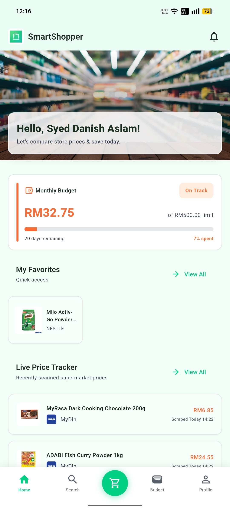
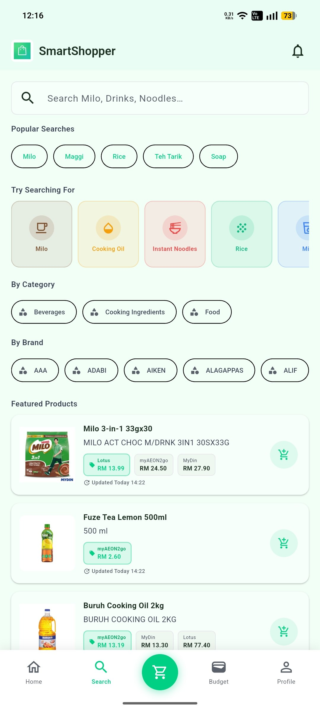
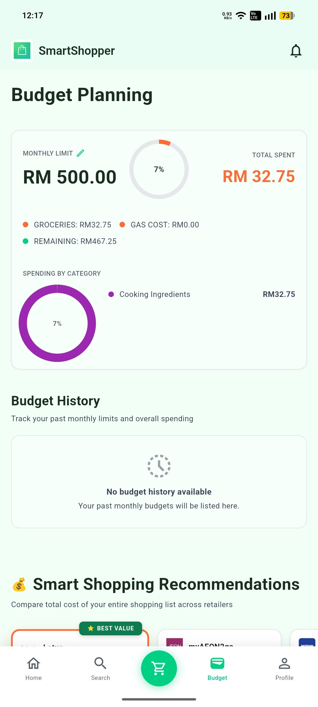
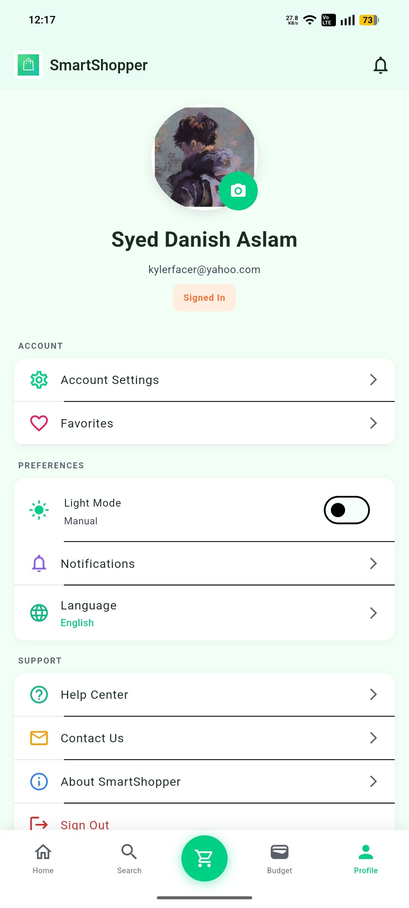

# SmartShopper Mobile

**A grocery price-comparison app for Malaysian shoppers that compares the cost of a whole shopping list across stores, and subtracts the cost of driving there.**

SmartShopper is a Flutter mobile app backed by Firebase. Instead of comparing single items, it totals an entire basket at Mydin, Lotus's and myAEON2go, estimates the fuel cost of the trip using your GPS location, and shows your **net saving**. Gemini AI adds cheaper house-brand swaps and local recipe ideas.

> **Final Year Project**
> Bachelor's degree project, UiTM Campus Jasin, CDCS251, 2026.
> Supervisor: Mohd Hafidz bin Rahmat

<table align="center">
  <tr>
    <td align="center">
      <br>
      <em>Home</em>
    </td>
    <td align="center">
      <br>
      <em>Search</em>
    </td>
    <td align="center">
      <br>
      <em>Budget</em>
    </td>
    <td align="center">
      <br>
      <em>Profile</em>
    </td>
  </tr>
</table>

---

## Features

### Smart price comparison
- **Basket-level totals.** Compares the whole shopping list per retailer, not item by item.
- **Fallback pricing.** If a store does not stock an item, the cheapest price from the other stores is used so totals stay comparable.
- **Availability indicator.** Shows "X of Y items available" for each retailer.
- **Search ranking.** Products sold at several retailers appear first, which makes cross-store comparison easier.
- **Favorites and shopping lists**, including an active list for use while shopping.

### Distance-aware net savings
- Calculates the distance from your location to the nearest branches in Melaka (Mydin Jasin, Lotus's Melaka and AEON Melaka) using the Haversine formula.
- Estimates the round-trip fuel cost with RM 3.47 per litre (RON 95) and 12 km per litre (a typical small city car).
- Shows a **Net Save** or **Net Loss** after subtracting travel cost from the grocery saving.
- Falls back to OpenStreetMap (Nominatim) if no Google Geocoding key is configured.

### AI insights (Google Gemini)
- **Brand swaps.** Spots premium brands in your list and suggests cheaper house brands with the reason for the saving.
- **Recipe suggestions.** Search for an ingredient and get a local Malaysian dish, with ingredient chips that jump straight to searching for that item.

### Budgets, alerts and notifications
- Budget tracking with alerts when a limit is exceeded.
- Price-drop alerts and a weekly savings digest.
- Push notifications through Firebase Cloud Messaging.

### Scraping pipeline
- Collects prices through the retailers' own REST endpoints (Lotus's, Mydin and AEON storefront data) rather than rendering HTML pages.
- Scrapers run in parallel with `Future.wait`, which cut a full scrape from over 12 seconds to about 3 to 4 seconds in testing.
- The product catalog is cached in memory to avoid repeated full-collection Firestore reads.
- An admin screen in the app can start and monitor a scrape.

### Other
- English and Bahasa Malaysia interface.
- Email and Google sign-in, with a password-reset flow.
- Help center and contact screens.

## Architecture

```
Flutter app (Riverpod)  <-->  Firebase Auth / Firestore / Storage / FCM
        |                              ^
        | Gemini API                   | Cloud Functions (notifications)
        v                              |
   AI recommendations        Admin web dashboard (Firebase Hosting)
```

**Tech stack**

| Layer | Technology |
| :--- | :--- |
| App | Flutter and Dart, Material 3 |
| State management | Riverpod |
| Backend | Firebase Authentication, Cloud Firestore, Cloud Storage, Cloud Messaging |
| Server logic | Firebase Cloud Functions (Node.js) |
| AI | Google Gemini (`google_generative_ai`) |
| Location | `geolocator`, Google Geocoding API, OpenStreetMap Nominatim |
| Admin dashboard | HTML, CSS and JavaScript on Firebase Hosting |
| Dev tooling | A custom Dart MCP server (`mcp_server/`) |

### Project structure

```
smartshopper-mobile/
├── lib/
│   ├── config/            # Theme, routes, Firebase, Gemini and Maps configuration
│   ├── data/models/       # Product, Price, Retailer, Budget, ShoppingList, User, Notification
│   ├── providers/         # Riverpod state (cart, budgets, auth, search, language, location)
│   ├── screens/           # auth, home, products, shopping, profile, notifications, admin, support
│   ├── services/          # Firestore, FCM, location, AI recommendations
│   │   └── scrapers/      # Mydin, Lotus's and myAEON2go scrapers
│   ├── utils/             # Stable ID hashing, helpers
│   └── widgets/           # Shared UI components
├── android/               # Android project
├── functions/             # Firebase Cloud Functions (push notification delivery)
├── smartshopper_admin/    # Admin dashboard (web)
├── mcp_server/            # Dart MCP server for Claude, Cursor and similar tools
├── test/                  # Unit and widget tests
├── firestore.rules        # Firestore security rules
└── firebase.json
```

### Admin dashboard

A separate web app in `smartshopper_admin/` for administrators: dashboard overview, products, retailers (including store coordinates), users, notifications, scraper control, support messages and settings. Because it can send push notifications as a copyable payload, notifications can also be triggered from the free Firebase Console.

## Getting started

### Prerequisites
- Flutter SDK and Dart `^3.7.2`
- Android SDK (API 21 or higher) and a device or emulator
- A Firebase project with Authentication (email and Google), Firestore and Storage enabled
- Node.js 22 (only for Cloud Functions and the scraping scripts)

### Set up

```bash
git clone https://github.com/malsaaaa/smartshopper-mobile.git
cd smartshopper-mobile
flutter pub get
```

1. **Firebase.** Create your own Firebase project and run `flutterfire configure`, or replace `lib/config/firebase_options.dart` and `android/app/google-services.json` with your project's files.
2. **Security rules.** Deploy `firestore.rules` with `firebase deploy --only firestore:rules`.
3. **Gemini key** (optional, enables AI features). Pass it at launch instead of writing it into the code:
   ```bash
   flutter run --dart-define=GEMINI_API_KEY=your_key
   ```
4. **Google Geocoding key** (optional, for more accurate store lookup). Put your own restricted key in `lib/config/google_maps_config.dart`. Without it, the app uses OpenStreetMap.

### Commands

| Command | Purpose |
| :--- | :--- |
| `flutter run` | Run on a connected device or emulator |
| `flutter analyze` | Static analysis |
| `flutter test` | Run the tests |
| `flutter build apk` | Build a release APK |

### Deploy the admin dashboard and functions

```bash
firebase deploy --only hosting,functions
```

## Tests

The `test/` folder covers the notification logic: price-drop alerts, budget-limit alerts, and the weekly digest content and formatting, plus a widget smoke test.

```bash
flutter test
```

## Data and scraping notice

Price data is collected from public retailer storefronts for **academic research and demonstration** only. This project is not affiliated with or endorsed by Mydin, Lotus's or AEON. Store names and logos belong to their owners. Prices may be out of date or incomplete and should be confirmed in store.

## Limitations

- Store locations and the fuel-cost model are set up for **Melaka**, Malaysia.
- The fuel price (RM 3.47 per litre) and efficiency (12 km per litre) are fixed constants in the code.
- Scrapers depend on the retailers' site structure and may need updating if those sites change.
- Android is the supported platform. The admin dashboard is a separate web app.

## Acknowledgements

Thanks to my supervisor, Mohd Hafidz bin Rahmat, and to UiTM for supporting this project.

## License

Copyright (c) 2026 malsaaaa. All rights reserved.

This repository is public for viewing and portfolio purposes. No license is granted to copy, modify, distribute or use the code without the author's written permission.
